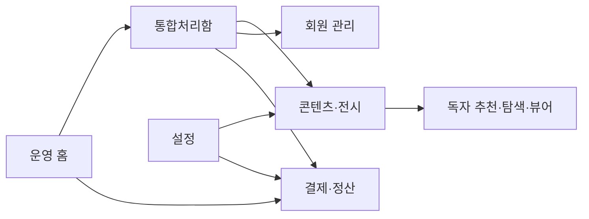
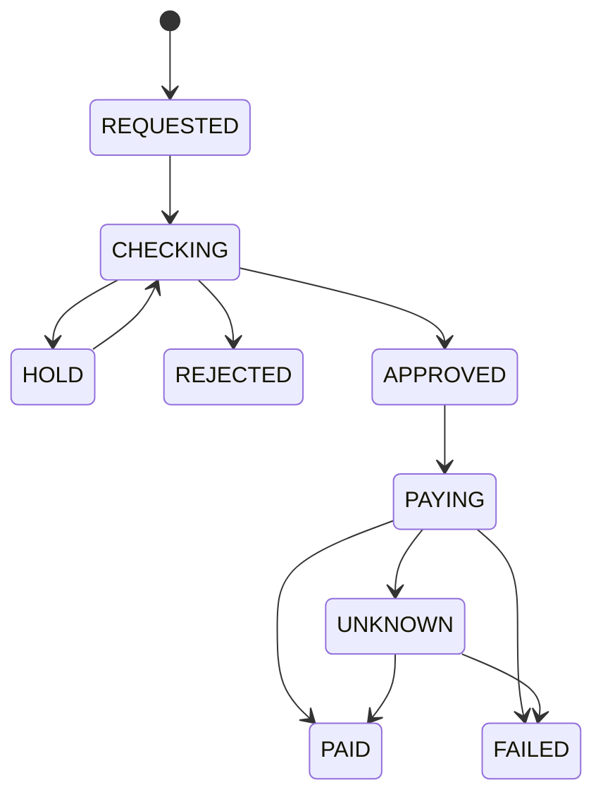

# Webnovels 관리자 최소 메뉴와 수익 운영 개발계획

기준일: 2026-11-01 KST. 대상: `webnovels.uk`, 최초 분석 기준 커밋 `4100bb21c480d5c981ac8ed51e6083f573c47af1`.

관리자는 **운영 홈, 콘텐츠·전시, 회원 관리, 결제·정산, 통합처리함, 설정**의 6개 상위 메뉴로 업무를 수행한다. 기존 14개 메뉴의 기능은 관련 상세 화면과 업무 탭으로 합친다. 추천은 관리자가 직접 선정한 작품만 노출한다. 포인트 충전과 회차 구매, 서류 확인과 실제 지급을 각각 구분하여 운영 실수를 줄인다.

최초 결과물은 분석과 개발계획이며, 후속 OP-01·OP-02 구현 기록을 아래에 연결한다. OP-03 추천·전시 CMS는 코드와 운영 DB 적용·서비스 RPC 검증을 완료했으며 브라우저·실기기 인수는 미실행이다. OP-04는 별도 TEST 경로의 무료 범위·가격·지갑·열람권 코드를 구현하고 개별 검증을 완료했으며 전체 릴리스·타입·독립 리허설·Git/배포 결과를 집계 중이다. 019 SQL은 미적용이고 운영 가격·금융 플래그·실제 결제·광고와 R13의 개인정보 접수 보류 조건을 변경하지 않는다.

## 1. 확정 서비스 모델과 남은 정책

### 사용자 확정 사항

| 항목 | 적용 기준 |
| --- | --- |
| 무료 회차 | **가입한 독자는 작품의 1~2화를 무료로 열람** |
| 이후 회차 | 허용된 광고 보상 또는 충전 포인트로 열람 |
| 충전 | 카드결제 또는 무통장입금으로 충전상품에 정해진 포인트 지급. 예: 10,000P |
| 회차 가격 | **기본 100P 차감**, 관리자가 상품·작품 정책에 따라 변경 |
| 추천 | **관리자가 직접 검색·선정·정렬·게시·중단**. 미선정 작품 자동 편입 금지 |
| 작가 권한 | 공개 전 작성·수정·최초 즉시/예약 발행은 작가 권한. 이미 공개한 내용의 수정·삭제는 관리자 승인 후 반영 |
| 최소 메뉴 | 서로 연관된 기능을 합치되 금융·개인정보의 권한과 처리 이력은 구분 |

**충전상품과 열람상품을 별도로 관리한다.** 충전상품은 `결제금액(KRW) + 지급 포인트`이고, 열람상품은 `대상 회차 + 차감 포인트`다. 10,000P 상품의 원화 가격이나 1P의 원화 가치는 아직 확정되지 않았다. 예를 들어 잔액 10,000P에서 3화를 100P로 구매하면 9,900P가 남으며, 이미 구매한 3화를 다시 읽을 때는 재차감하지 않는다.

### 계획상 제안과 출시 전 확정값

| 구분 | 제안 또는 확정 필요 사항 |
| --- | --- |
| 비회원 | 작품 탐색·소개·회차 제목 열람, 본문은 가입/로그인 안내. 현재 무료 베타의 접근은 별도 전환 전 유지 |
| 포인트 구매 권리 | 안정적인 회차 ID에 결합한 재열람 권리. 서비스·권리 제한 시 접근 중단과 구매 기록 보존을 구분 |
| 광고 보상 | 해당 회차 1개 열람권. 초기 유효기간 **24시간 제안**, 실제 값은 확정하고 광고 시작 전에 표시 |
| 무료 2화 적용 | 정규 회차 1·2화 기준. 프롤로그·휴재 공지는 별도 유형으로 정하고 무료 회차 수를 소모시키지 않는 방안 |
| 무료 제공 추가 | 관리자가 명시적으로 설정한 무료 이벤트만 추가. 기본 2화를 운영 중 조용히 축소하지 않음 |
| 충전상품 | 우선 유상 포인트 상품부터 운영. 보너스 상품은 원장·환불 규칙이 준비된 후 추가 |
| 유상 포인트 만료 | 초기 자동 소멸 미적용 제안. 기한을 도입하려면 사전 고지·약관·정책 버전 필요 |
| 작가 정산 | 배분율·정산 주기·최소 출금액·공제 항목·세무 유형·지급 방식은 별도 확정. 과거 화면의 62.5%를 확정 정책으로 사용하지 않음 |

## 2. 현재 사이트와 구현 진단

아래 진단은 최초 분석 당시의 기준선이다. 이후 OP-01·OP-02와 OP-03 코드 구현의 진행·적용 상태는 11절 및 각 단계 기록을 따른다.

공개 HTTP에서 `webnovels.uk`와 Pages 기본 도메인의 루트·공개 설정 응답은 200이며, 양쪽 모두 R13 로더와 정산 관리 진입점이 확인된다. 공개 설정은 `freeBetaEnabled=true`, 작가 발행·독자 서비스 활성 상태다. HTML 전체 해시의 차이만으로 배포 버전 차이를 판정하지 않는다. JS 실행 전 문서에는 숨겨진 구형 화면도 포함되므로, 현재 관리자 메뉴는 활성 라우터와 렌더러를 기준으로 평가한다.

이번 평가는 공개 HTTP·소스·기존 계약 문서 기준이다. 실제 관리자 로그인 화면, 실기기, 운영 거래·개인정보는 조회하지 않았다. 코드 그래프 도구는 연결 오류로 사용할 수 없어 지정된 저장소 파일을 확인했다.

| 영역 | 확인된 현재 상태 | 개발 판단 |
| --- | --- | --- |
| 관리자 메뉴 | 활성 경로에 14개 항목, 5개 그룹. 구형 관리자 탭도 별도 남아 있음 | 활성 디스패처부터 6개 메뉴로 통합. 구형 화면은 호환 조사 후 일상 동선에서 제외 |
| 추천 CMS | `HOME_RECOMMENDED/HOME_SPOTLIGHT`의 위치·기간·순서·미리보기·revision 구현 | 재사용. 독자 전용 추천 메뉴와 선정 목록 관리 확장 |
| 독자 홈 | 대표 추천 1개와 기획 추천 섹션 존재. 상단에 전용 추천 메뉴 없음 | 관리자가 선정한 목록을 읽는 추천 메뉴 추가 |
| 회원 | 활성 목록은 작가/독자 구분 및 최근 50개. 이메일·유료 독자·요청 중심 검색 부족 | 서버 검색·필터·페이지네이션과 회원 통합 상세 필요 |
| 작품 | 활성 업무 목록은 최근 100개 중심 | 작품 수가 늘어도 전 작품을 검색·관리할 수 있게 확장 |
| 독자 열람 | 공개 API가 FREE 회차에 한정 | 잠긴 회차의 메타데이터와 본문 권한을 분리해야 함 |
| 광고·포인트 | 현행 Cloudflare 경로는 준비 중/503, 화면 일부는 안내 버튼 | 검증된 보상과 원장 기반 구매를 추가. 버튼 노출만으로 출시하지 않음 |
| 결제 기반 | TEST 전용 주문·권리·불변 원장·환불 기반 존재. 운영 포인트 충전 엔진과 웹툰 결제는 추가 범위 | 유용한 계약은 확장하되 LIVE 플래그 전환만으로 운영하지 않음 |
| 작가 정산 | 기존 기록 조회와 R13 신원·계좌 준비. 실제 지급 엔진 없음 | 정산 요청·잔액 예약·승인·이체 증빙·실패 대사 추가 |
| API 설정 | TOSS/PASS 키 암호화 저장 지원. 저장이 실제 활성화를 뜻하지 않음 | 연결·TEST 검증·계약·운영 가능 상태를 별도로 표시 |

주요 근거: [관리자 활성 메뉴](../../public/js/admin/admin-operations.js#L12), [회원 API 조건](../../server/admin-workflow-api.mjs#L7), [회원·작품 조회](../../database/authoring/014_admin_workflow.sql#L176), [현재 무료 회차 경계](../../server/stage16-api.mjs#L38), [준비 중 수익 API](../../server/secure-api.mjs#L286), [TEST 결제](../../server/paid-episode-api.mjs#L8), [R13 정산 준비](ui-r13-settlement-registration-2026-11-01.md).

기존 `point_accounts`, `point_transactions`, `earning_ledger` 등도 존재한다. 새 원장을 만들기 전에 자료 출처·실제 호출 경로·기존 권리와의 대응을 감사한다. 구형 Express의 광고 검증 시뮬레이션이나 승인 즉시 `PAID`로 바꾸는 경로는 운영 금융 엔진으로 재사용하지 않는다. [기존 수익화 계약](monetization-contract.md), [기존 포인트 구조](../../database/05_reader.sql#L49), [구형 광고 서비스](../../src/services/adUnlock.service.ts#L34).

## 3. 상위 메뉴 6개와 기존 기능 정리

| 상위 메뉴 | 하위 업무 탭 | 상시 목록에서 제외할 기능 |
| --- | --- | --- |
| **운영 홈** | 오늘 할 일, 매출·열람·정산 요약, 장애·미확정 거래 | 상세 원장·과도한 통계 차트 |
| **콘텐츠·전시** | 작품·회차 / 추천·홈 구성 / 공지·정책 | 독립 회차 메뉴, 중복 추천 플래그 편집 |
| **회원 관리** | 작가 / 독자. 같은 검색·목록·상세 구조 | 별도 가상 계정 메뉴, 직접 비밀번호 변경 |
| **결제·정산** | 결제·입금 / 환불·포인트 / 작가 정산 / 대사 | 광고 수익·포인트·무통장·지급을 각각 분리한 상위 메뉴 |
| **통합처리함** | 미처리·내 담당·기한 초과, 문의·신고·변경·복구·이의제기 필터 | 유형마다 분리된 상위 검토 메뉴 |
| **설정** | 서비스 정책 / 외부 연동 / 운영자·권한 / 감사·상태 | 일상 업무에 노출되는 시험 도구와 기술 용어 |



메뉴를 줄여도 상태 저장소를 임의로 합치지 않는다. 통합처리함은 원래 문의·신고·변경·입금·환불·지급의 상태를 읽는 **조회·배정 화면**이다. 하나의 범용 `완료` 버튼으로 지급·환불·승인 상태를 바꾸지 않는다.

### 기존 14개 항목의 목적지

| 기존 항목 | 이동 위치 |
| --- | --- |
| 운영 대시보드 | 운영 홈 |
| 문의·베타 운영 | 문의는 통합처리함, 서비스 상태는 설정 |
| 작품·변경 검토 | 작품은 콘텐츠·전시, 공개본 변경 요청은 통합처리함에서 해당 작품으로 연결 |
| 회차 조회 | 작품 상세의 회차 탭 |
| 홈 편집 추천 | 콘텐츠·전시 → 추천·홈 구성 |
| 신고·콘텐츠 검수 | 통합처리함 → 신고/권리·등급/공개본 변경 필터 |
| 원고 복구 검토 | 통합처리함 → 원고 복구 |
| 이의제기 | 통합처리함 → 이의제기 |
| 작가·독자 관리 | 회원 관리 |
| 가상 계정 시험 도구 | 설정 → 제한된 시험 도구, 최고 관리자만, 기본 접힘 |
| 작가 정산 | 결제·정산 → 작가 정산 |
| 서브관리자·권한 | 설정 → 운영자·권한 |
| 감사·처리 기록 | 설정 → 감사·상태, 각 상세에서 관련 이력 링크 |
| 서비스 운영 설정 | 설정 → 서비스 정책·외부 연동 |

팬미팅·굿즈·일반 커머스 등 현재 핵심 모델 밖 기능은 일상 메뉴에 넣지 않는다. 기존 URL·영속 권한·호환 ID를 먼저 조사하고, 화면 정리를 이유로 데이터를 삭제하거나 일괄 이름 변경하지 않는다.

경로 이관안은 `/admin`(운영 홈), `/admin/content`, `/admin/members`, `/admin/finance`, `/admin/inbox`, `/admin/settings`다. 실제 구현에서는 기존 라우터 계약을 확인해 확정한다. `/admin/works`, `/admin/episodes`, `/admin/curation`은 콘텐츠의 해당 탭으로, `/admin/accounts`는 회원 관리로, `/admin/settlements`는 작가 정산 탭으로 연결한다. 복구·이의제기·감사 등의 기존 상세 링크도 대상 ID와 필터를 보존한다. 기존 경로를 먼저 삭제하지 않는다.

## 4. 공통 관리 화면 UX

### 화면 구성

```text
┌ Webnovels 운영 ─ 전역 검색: 회원·작품·주문·요청번호 ─ 담당자 ┐
│ 운영 홈        │ 화면 제목                  주요 처리 버튼   │
│ 콘텐츠·전시    │ [기본 탭] [관련 탭]                         │
│ 회원 관리      │ 검색어 / 자주 쓰는 필터 / 내 저장 조건       │
│ 결제·정산      │ 결과 목록                    선택 항목 상세  │
│ 통합처리함     │                                              │
│ 설정          │ 처리 결과 / 근거 / 변경 이력 / 관련 업무      │
└──────────────────────────────────────────────────────────────┘
```

- 검색 입력과 기본 필터는 상단에 고정한다. 고급 필터는 펼쳐서 사용한다.
- 목록은 50개 단위 서버 페이지네이션을 기본으로 하고 일반 필터·정렬·페이지를 URL에 보존한다. 상세에서 돌아와도 검색 결과와 스크롤을 유지한다. 이메일·연락처 등 개인정보 검색값은 URL·브라우저 저장소·일반 로그에 넣지 않고 인증된 요청 본문과 일시적인 화면 상태로 처리한다.
- 선택한 회원·작품·거래의 상세를 옆 패널 또는 독립 URL로 연다. 모바일에서는 독립 상세 화면을 사용한다.
- 목록에는 업무 판단에 필요한 6~8개 열을 우선 표시하고, 세부 정보·원장은 상세로 옮긴다.
- `검색 결과 없음`, `조회 실패`, `연결 미준비`, `권한 없음`을 다른 상태로 표시한다. 0원과 미집계를 구분한다.
- 작업 중에는 중복 클릭을 막고, 응답 유실은 같은 요청 키로 재조회한다. 저장 실패를 성공으로 표시하지 않는다.
- 금액·계좌·개인정보·공개 상태 변경은 사유·최신 revision·권한을 서버에서 확인한다. 필요한 단계의 재인증과 분리 승인은 메뉴 수 축소와 무관하게 유지한다.
- URL/검색 결과/감사 로그에 신분증·전체 계좌·주민등록번호·비밀번호를 노출하지 않는다.

업무 목표는 **검색 → 상세 → 처리 진입을 3번 이내 주요 조작으로 수행**하는 것이다. 실제 지급·환불의 추가 확인·재인증·분리 승인을 이 목표 때문에 생략하지 않는다.

## 5. 메뉴별 필수 기능

### 5.1 운영 홈

첫 화면은 누적 회원 수보다 **오늘 처리해야 할 일**을 우선한다.

| 요약 카드 | 클릭 시 이동 |
| --- | --- |
| 미확인 입금·입금 불일치 | 결제·정산의 입금 대조 필터 |
| 환불·결제 결과 미확정 | 해당 거래 상세와 대사 |
| 정산 요청·지급 실패 | 작가 정산의 해당 상태 |
| 공개본 수정·삭제 요청 | 통합처리함의 변경 검토 |
| 신고·고객 문의·기한 초과 | 통합처리함의 담당/기한 필터 |
| 추천 종료 예정·빈 추천 영역 | 추천 편집 화면 |

보조 지표는 충전 결제 수납액(승인·환불·순수납), 포인트 발행/소비/잔액, 회차 소비 매출, 검증 광고 보상, 확정 광고 수익, 지급 예정/완료로 구분한다. **충전 수납액과 회차 소비 매출을 더해 총매출로 표시하지 않는다.** 기존 미확정 수익을 확정 매출로 합산하지 않는다. 자세한 분석은 관련 업무 화면에서 기간을 선택해 확인하며 별도 상위 통계 메뉴를 만들지 않는다.

### 5.2 콘텐츠·전시

**작품 목록**: 썸네일·제목, 웹소설/웹툰, 필명, 공개 상태, 회차 수/최근 발행, 열람 정책, 미처리 요청을 표시한다. 제목·작품 ID·작가 검색, 유형·공개 상태·완결·추천 선정·과금 상태 필터를 제공한다.

**작품 상세 탭**: `작품 정보 / 회차 / 노출·열람 정책 / 이력`. 회차에서는 발행일·제목·가격/무료·열람수·공개본 확인·변경 검토를 제공한다. 회차 원문 수정은 기존 작가 초안·관리자 승인 계약을 사용한다.

**홈 구성**: 초기에는 아래의 정형 블록만 관리한다. 임의 HTML·JavaScript·CSS를 붙이는 범용 페이지 빌더는 도입하지 않는다.

| 블록 | 관리 항목 |
| --- | --- |
| 대표 추천 | 관리자가 선정한 작품 1개, 표시 문구·기간 |
| 추천 작품 목록 | 수동 선정·순서·노출 범위, 홈 일부와 추천 페이지 연계 |
| 최신 연재 | 서버의 발행 정보 기반, 웹소설/웹툰 구분 |
| 인기 랭킹 | 실제 열람 집계 기반, 편집 추천과 분리 |
| 공지·이벤트 안내 | 제목·본문·허용된 링크·시작/종료. 미운영 이벤트 기능을 자동 연결하지 않음 |
| 정책·푸터 | 회사 연락처·공지·약관 링크·문서 버전 |

메뉴 관리도 `홈/웹소설/웹툰/추천/랭킹` 등 허용된 공개 경로의 표시명·순서·노출 여부만 편집한다. 관리자 경로나 임의 외부 스크립트를 메뉴에 삽입할 수 없게 한다. 필수 회사·정책·고객지원 링크는 일반 편집으로 지우지 못하게 한다.

전시 변경은 `초안 저장 → 관리자 미리보기 → 발행/예약 → 종료/게시 중단`으로 처리한다. 직전 발행 버전 복구, 변경 사유, 담당자·시각·revision, 캐시 갱신을 포함한다. 날짜 입력은 KST로 안내하고 DB에는 UTC로 저장한다. 관리자용 미리보기 자료가 일반 독자에게 노출되지 않게 한다.

### 5.3 관리자 직접 선정 추천

**선정 원칙**: 관리자가 저장한 작품 ID만 추천 후보가 된다. 조회수·매출·장르·개인화 점수로 선정 작품을 자동 추가하지 않는다. 선택 목록을 정렬할 때도 관리자가 저장한 순서를 따른다. 랭킹은 별도의 화면이다.

**관리 흐름**:

1. 콘텐츠·전시 → 추천·홈 구성에서 작품명·필명·작품 ID로 검색한다.
2. 검색 결과의 실제 공개 상태·등급·썸네일·소개를 보고 직접 선택한다.
3. 선정 목록에서 순서를 옮기고, 필요하면 홈 대표/기획 노출과 시작·종료 시각을 정한다.
4. 독자 화면 미리보기 후 게시한다. 관리자끼리 동시 편집하면 최신 버전을 재확인한다.
5. 선정 해제·기간 종료·게시 중단 시 목록에서 내려간다. 이미 부여한 열람권이나 작품 원문은 변경하지 않는다.

| 선정 목록의 기본 열 | 처리 |
| --- | --- |
| 순서 / 작품·작가 / 작품 유형 / 공개 가능 상태 / 노출 위치 / 기간 / 게시 상태 | 순서 변경, 노출 수정, 미리보기, 게시, 선정 해제 |

선정했더라도 비공개·차단·미발행·이용등급 조건 미충족 작품은 서버가 독자 목록에서 제외하고, 관리자에게 제외 이유를 표시한다. **다른 인기작으로 자동 대체하지 않는다.** 선정이 비어 있으면 독자 추천 페이지에 준비 중 안내를 표시한다. 같은 선정 목록 안의 작품 중복은 금지한다. 동일 선정 작품의 홈 대표·기획·추천 페이지 배치는 같은 선정 ID를 참조하며 별도 추천 후보를 자동 생성하지 않는다.

OP-03에서는 **하나의 새 전시 문서**에 최대 200개 수동 선정과 홈·공지·메뉴를 함께 저장한다. 추천 페이지는 24개 단위로 제공하며, 홈의 같은 시각 대표 1개·사용 설정 기획 8개 제한과 분리한다. 기간·순서·공개 적격성 원칙은 유지한다. 기존 `HOME_RECOMMENDED/HOME_SPOTLIGHT`와 추천 플래그는 이관 검토용 읽기 자료로 보존하고 자동 복사하지 않는다. 018 적용 시 구형 쓰기 원천을 차단하여 새 목록과 이중 편집하지 않는다. 구현·검증과 적용 대기는 [OP-03 기록](op03-manual-display-cms-2026-11-01.md)을 따른다.

### 5.4 회원 관리와 작가 정보

상위 메뉴는 하나로 유지하고 **작가 / 독자** 탭에서 업무에 맞는 열과 필터를 보여준다. 인증 계정·작가 프로필·독자 프로필의 ID를 별도로 보존하며, 한 본인의 복수 ID·필명을 이름으로 병합하지 않는다.

**작가 목록**:

| 기본 열 | 바로 확인할 정보 |
| --- | --- |
| 필명·작가 ID | 계정 연결 상태와 유형 |
| 작품 수·최근 발행 | 연재 중·완결 작품으로 이동 |
| 계정 상태 / 작품별 연재 상태 요약 | 계정 제한·복구와 각 작품의 연재·휴재·완결을 구분 |
| 정산 준비 | 계좌 등록·서류 확인·금융기관 확인을 구분 |
| 정산 요청/출금 가능액 | 확정 자료만 표시, 미연결은 미집계 |
| 미처리 요청 | 문의·변경·정산 바로가기 |

검색은 필명·작가 ID·허용된 이메일 검색, 필터는 상태·최근 활동·작품 유무·정산 준비·미처리 요청을 제공한다. 상세는 `기본 정보 / 작품 / 정산 / 요청·이력`으로 구성한다. 공개 필명·소개는 권한·revision·사유·감사와 함께 수정할 수 있게 개발한다. 이메일·신원·수취 계좌 변경은 재확인 요청을 거치며, 이름 입력만으로 Auth 계정을 재연결하지 않는다. 비밀번호 원문 조회·관리자 직접 덮어쓰기는 제공하지 않는다.

작가 한 명이 연재·휴재·완결 작품을 동시에 가질 수 있다. 작가 계정에 하나의 휴재 상태를 새로 만들거나, 계정 복구 시 모든 작품을 연재 재개하지 않는다.

신분증 원문은 일반 작가 목록에 넣지 않는다. 정산 담당자는 확인 상태를 보고, R13의 최고 관리자 자료 열람 경계는 별도로 유지한다. 수동 서류 확인을 PASS 또는 은행 확인으로 표시하지 않는다.

**독자 목록**:

| 기본 열 | 정의 |
| --- | --- |
| 닉네임·독자 ID·계정 상태 | UUID/인증 계정 연결 구분 |
| 가입일·최근 활동 | 기간 검색 가능 |
| 결제 상태 | 결제 이력 있음 / 순결제액 있음 / 전액 환불 등을 구분 |
| 충전 잔액 | 유상 포인트·보너스/보상 출처 구분 |
| 최근 결제·미처리 요청 | 주문·문의·환불 상세로 연결 |

필수 검색은 닉네임·독자 ID·허용된 이메일·주문번호다. `최근 30일 결제`, `결제 이력 전체`, `순결제액>0`, `입금 대기`, `환불 요청`, `잔액 있음`, `문의 미처리`, `제한 계정`을 저장 필터로 제공한다. 순결제액은 서버 승인/입금 확정액에서 취소·환불을 차감한 금액으로 산출하며, 결제창 진입·TEST 주문·미입금은 유료 독자로 세지 않는다.

독자 상세는 `계정 / 결제·포인트 / 구매·열람권 / 요청·이력`이다. 고객지원은 주문과 열람권을 같은 화면에서 확인한다. 잔액 숫자를 직접 편집하지 않고 사유·승인·원장에 근거한 조정 절차를 사용한다. 운영자 제공 이용권도 유상 결제와 별도 출처로 기록한다.

### 5.5 결제·정산

**결제·입금 탭**: 주문번호·독자·상품·수단·금액·포인트·상태·신청/확정 시각을 표시한다. 카드 승인, 수동 입금 대조, 미확정 거래 재조회가 핵심 행동이다.

**환불·포인트 탭**: 원결제·충전 묶음·소비·현재 환불 가능 범위·요청 사유·외부 취소 상태를 연결한다. 포인트 지급/회수와 PG 취소를 별도로 완료한 것처럼 처리하지 않는다.

**작가 정산 탭**은 가장 먼저 `요청 대기 / 보류 / 승인 / 이체 중 / 지급 완료 / 실패·미확정`을 보여준다.

| 정산 목록 기본 열 | 상세에서 확인 |
| --- | --- |
| 요청일·작가·대상 기간·요청액·지급 가능액·준비 상태·진행 상태 | 작품별 매출 근거, 광고 확정 수익, 환불/공제, 계좌 버전, 증빙, 담당자·변경 이력 |

작가 상세에서 정산 요청으로 바로 이동하고, 정산 상세에서 작가의 작품·문의·서류 확인 상태로 이동한다. 임의의 수익 숫자를 대신 입력하거나 문서 확인만으로 지급 가능 상태를 만들지 않는다.

**대사 탭**: 승인/입금과 포인트 발행, 포인트 소비와 회차 권리, 작가 수익과 출금 예약, 실제 은행 이체를 연결해 불일치를 조회한다. 정상 거래를 수동으로 반복 처리하는 화면보다 사람이 해결할 예외를 먼저 보여준다. 원본 금융 기록은 수정 대신 조정/역분개로 남긴다.

### 5.6 통합처리함

문의·신고·공개본 수정/삭제·복구·이의제기를 같은 목록에서 검색하고 배정한다. 입금·환불·정산 예외도 관련 금융 상세로 연결한다. 기본 열은 `유형·대상·제목·상태·우선순위·담당자·접수일/기한`이다.

목록의 공통 상태는 원래 도메인 상태를 요약한 표시다. 실제 완료·승인·취소는 해당 도메인의 API·원장·권한을 통해 수행한다. 공개본 변경 승인, 환불 완료, 지급 완료를 하나의 상태 변경 RPC로 통합하지 않는다.

### 5.7 설정과 외부 연동

| 업무 탭 | 필수 항목 |
| --- | --- |
| 서비스 정책 | 무료 2화, 회차 기본 100P, 광고 보상 기간·한도, 작가 계약/배분 정책 버전. 충전상품은 관련 편집 화면으로 연결 |
| 외부 연동 | 카드 PG, 광고 보상 제공자, 입금 확인 방식, 본인/계좌 확인, SMTP, 저장·백업 상태 |
| 운영자·권한 | 역할 템플릿, 업무별 읽기/수정/승인 범위, 재인증·담당자 분리 |
| 감사·상태 | 변경 이력, 콜백 실패, 결제 미확정, 정리 작업 실패, 배포·도메인 상태 |

연결 상태는 `미설정 → 키 저장 → TEST 검증 → 계약/고지 확인 → 운영 가능 → 중단/장애`로 구분한다. “키 저장 성공”이나 단순 HTTP ping을 “결제 가능”으로 표시하지 않는다. 비밀값은 다시 조회하지 않고 마스킹·교체·버전·변경자 이력만 표시한다. TEST/LIVE를 구분하고 회전 시 기존 키로 읽어야 할 자료와 콜백 유효 범위를 보존한다.

초기 권한 템플릿은 최고 관리자, 콘텐츠 운영, 고객지원, 재무 담당으로 충분하다. 개인정보 원문·지급·환불·키 교체 권한은 별도로 제한하고 API와 DB에서 재검증한다. 기존 `CREATOR_MGMT` 등 영속 권한은 호환 매핑 후 전환한다.

| 역할 | 일반 업무 | 별도 승인 또는 차단 |
| --- | --- | --- |
| 콘텐츠 운영 | 작품·회차 조회, 추천·전시, 배정된 콘텐츠 요청 | 계좌·신분증·포인트 원장 조정·지급·비밀키 접근 차단 |
| 고객지원 | 권한 범위의 회원·주문 상태 조회, 문의 답변, 환불 요청 접수 | 환불/지급 완료 처리와 개인정보 원문 열람은 별도 권한 |
| 재무 담당 | 결제 대사·환불·정산 검토. 승인/실행 권한 분리 | 신분증은 확인 상태만 참조, 원문 열람은 R13 최고 관리자 경계 유지 |
| 최고 관리자 | 역할·연동·예외 정책 관리 | 민감 작업도 서버 재인증·사유·감사 적용. 등록 MFA를 우회하지 않으며 운영용 단계 인증을 인수 |

권한 없는 열은 목록에서 숨기고 서버 조회 결과에서도 제외한다. 메뉴를 숨기는 것만으로 보호하지 않는다. API 연결 상태와 민감값 열람 권한도 구분한다.

가격의 편집 위치는 **설정=플랫폼 기본 정책, 작품 상세=작품별/필요한 회차별 가격 예외, 결제·정산의 결제·입금=충전상품 KRW 가격과 지급 포인트**로 정한다. 다른 화면에는 현재 값과 해당 편집 화면 링크만 제공한다. 가격 수정 권한은 일반 추천·콘텐츠 편집 권한과 구분한다.

## 6. 독자 프런트 메뉴와 열람 UX

### 독자 메뉴 제안

주요 메뉴는 **홈 / 웹소설 / 웹툰 / 추천 / 랭킹** 5개다. 현재 신작·완결은 웹소설/웹툰 탐색의 고정 필터로 제공하고 기존 URL은 유지한다. 내 서재·포인트·로그인·작가 스튜디오는 사용자 영역에 둔다.

추천 페이지는 관리자 선정 목록을 사용하며 유형·장르로 좁혀 볼 수 있다. 필터는 선정 집합 안에서만 작동한다. 선정이 없는 장르를 자동 생성 추천으로 채우지 않는다. 관리자에게는 “추천 페이지의 선정 목록”과 “홈에 실제 보이는 결과”를 함께 미리보기로 제공한다.

### 작품 상세와 회차 목록

- 1~2화: `회원 무료`. 비회원에게는 `가입하고 2화까지 무료로 읽기` 안내.
- 3화 이후: `100P` 또는 작품별 현재 가격, `광고로 무료 열람 가능` 여부, 이미 가진 권리와 남은 기간을 함께 표시.
- 이미 구매했으면 `다시 읽기`, 광고 권리가 유효하면 `무료 열람권으로 읽기`를 우선 표시하고 재차감하지 않음.
- 잔액 부족이면 충전상품으로 이동하되 대상 작품·회차와 현재 위치를 보존하고 충전 후 복귀.
- 광고 미충전·차단·취소는 구분해서 안내하고, 포인트 대안을 표시. 실패한 광고를 성공으로 간주하거나 자동 차감하지 않음.

뷰어의 다음 화 요청은 항상 같은 서버 권한 판정기를 통과한다. 웹소설 본문·웹툰 패널·이미지 접근·공유 링크·직접 API 모두 동일하게 적용한다. 잠긴 본문이나 이미지 원본을 HTML/JS에 미리 넣고 CSS로 가리는 방식은 사용하지 않는다.

## 7. 가격과 열람권 처리 계약

### 공개 목록과 본문 분리

| 콘텐츠 상태 | 목록·소개 | 본문·이미지 |
| --- | --- | --- |
| 공개·회원 무료 회차 | 제목과 무료 표시 | 등록 회원에게 무료 |
| 공개·잠금 회차 | 제목·가격·광고 가능 여부 표시 | 유효한 광고/구매 권리 확인 후 제공 |
| 비공개·발행 전·제재·권리 제한 | 기존 공개 정책에 따라 제외 | 결제·광고 권리가 있어도 무조건 우회 허용하지 않음. 구매 기록은 보존하고 문의·환불 처리로 연결 |

현재 무료 회차만 공개하는 API를 이 계약으로 확장해야 한다. 관리자 가격 설정만 만들고 독자 목록을 그대로 두면 유료 회차가 보이지 않는 문제가 남는다.

### 회차 차감

1. 서버가 회원·작품·회차·가격 버전·금액·견적 만료를 확정한다.
2. 결제 직전 공개 적격성·등급·기존 권리·현재 가격을 다시 확인한다.
3. 견적 이후 회차 가격이 바뀌면 **미차감 상태로 재확인**을 요청한다. 클라이언트가 보낸 100P를 신뢰하지 않는다.
4. 잔액 차감·소비 원장·회차 권리·작가 수익 근거를 한 DB 트랜잭션으로 기록한다.
5. 중복 클릭·두 탭·재전송·응답 유실에도 한 번만 차감한다.

권리는 안정적인 회차 ID에 연결하고 거래에는 당시 공개 버전·가격·정책 스냅샷을 남긴다. 작가의 승인된 공개본 수정 때문에 같은 회차를 다시 구매하게 하지 않는다. 광고·구매·이벤트 이용권은 출처별로 남겨 한 권리의 취소가 다른 유효 권리까지 지우지 않게 한다.

### 충전 상품

관리자는 상품명·지급 포인트·KRW 가격·판매 상태·판매 기간·주문 결제 기한·정책 버전을 입력한다. 상품 판매 기간·주문 결제 기한은 포인트 잔액의 소멸 기한과 구분한다. 결제 주문 생성 시 상품 조건을 고정하며, 상품 변경은 이미 진행 중인 결제 주문 금액을 바꾸지 않는다. 종료/만료 주문에 뒤늦게 입금된 경우는 별도 대조·환불 업무로 처리한다.

기존 잔액 숫자·이전 원장·TEST 권리는 자동 합산하지 않는다. 소유권·원거래·중복 대조 후 정식 원장 또는 검증된 이관/호환 경로를 정한다. 유상·보너스·광고 보상 출처와 원결제별 충전 묶음을 구분한다.

포인트 소비를 원화 수익으로 연결하는 기준도 버전화한다. 초기 유상 포인트는 원결제 묶음 순서로 소비를 배정하는 방식(FIFO)을 제안하며, 어떤 원거래에서 몇 P가 소비됐는지 남긴다. 충전상품별 실수납액·할인·계약상 공제와 배분 기준을 연결하고 `100P=100원`을 하드코딩하지 않는다. 원화 배분의 반올림·잔여액을 대사하여 충전·소비·환불의 합계가 맞도록 한다. 보너스·광고 이용권을 유상 매출로 자동 환산하지 않는다.

## 8. 광고 시청과 클릭 및 스크롤 정책

| 방식 | 열람 보상 조건 | 수익 반영 |
| --- | --- | --- |
| 공식 보상형 광고 | 명시적 선택 + 제공자 완료 증빙 검증 | 권리 발급과 광고사 확정 매출을 별도 기록 |
| 일반 광고 클릭 | 일반 AdSense 클릭을 열람 보상 조건으로 사용하지 않음 | 자체 클릭 이벤트로 광고 수익을 만들지 않음 |
| 허용된 클릭/전환 캠페인 | 해당 제공자 계약·정책에서 보상을 허용하고 서버 증빙을 제공하는 경우에만 별도 도입 | 계약상 검증·대사된 수익만 반영 |
| 스크롤 확인 | 운영자 제공 무료 캠페인의 참여 조건으로 한정하는 방안 | 광고사 검증 매출이 없는 한 자체 프로모션 비용/무료 제공으로 기록 |

Google 일반 AdSense 인벤토리는 클릭·노출 보상을 통한 유도를 허용하는 보상형 인벤토리와 구분된다. 기본 광고 동선은 공식 보상형으로 구성한다. [AdSense 정책](https://support.google.com/adsense/answer/48182?hl=en)

Google Ad Manager는 웹 보상형 광고와 SSV 콜백을 공식 문서에서 지원한다. 실제 네트워크·광고 단위에서 사용할 수 있는지, 콜백 인증·거래 ID·보상 세션 매핑을 인수한다. 브라우저의 `rewardedSlotGranted`는 대기 UI에 활용하고 서버 검증과 거래 중복 방지를 거쳐 권리를 확정한다. 타이머·광고 닫기·스크롤을 검증 완료 증거로 바꾸지 않는다. [웹 보상형 광고·SSV](https://support.google.com/admanager/answer/9116812?hl=en), [GPT 공식 예제](https://developers.google.com/publisher-tag/samples/display-rewarded-ad)

보상은 플랫폼 안의 본인용 회차 열람권으로 제공하고 유상 충전 포인트와 분리한다. 광고 선택 전에 보상 대상·기간·취소 조건을 표시한다. [보상 광고 정책](https://support.google.com/admanager/answer/7496282?hl=en)

보상 세션은 `요청 → 광고 선택 → 준비 → 보상 확인 대기 → 서버 증빙 검증 → 열람권 발급`으로 처리한다. 취소·미충전·만료·거절·콜백 지연은 별도 상태다. 회원·회차·유효기간·nonce·제공자 거래 ID를 묶고 하나의 거래로 두 번 권리를 발급하지 않는다. 타 사이트 광고 iframe의 클릭/스크롤을 일반 페이지가 읽을 수 있다고 가정하지 않는다. [동일 출처 정책](https://developer.mozilla.org/en-US/docs/Web/Security/Defenses/Same-origin_policy)

## 9. 결제 입금 환불과 작가 정산

### 카드와 입금

카드는 `CREATED → APPROVING → PAID`, 불명확한 응답은 `UNKNOWN → 제공자 재조회`로 처리한다. 성공 URL 복귀만으로 포인트를 지급하지 않는다. 서버 주문의 회원·상품·금액·통화와 제공자 승인 결과를 대조한 뒤 한 번만 지급한다. [Toss 결제 연동](https://docs.tosspayments.com/guides/v2/payment-widget/integration)

회사 계좌 무통장입금과 PG 가상계좌는 처리 방식이 다르다. 수동 입금은 `주문 생성 → 입금 대기 → 은행 내역 대조 → 확인 → 포인트 지급`이며, 독자의 입금 신고만으로 적립하지 않는다. 같은 이름·같은 금액은 자동 확정하지 않고 은행 거래 참조번호를 한 주문에만 연결한다. 가상계좌는 발급과 실제 입금 완료를 구분한다. [가상계좌 연동](https://docs.tosspayments.com/guides/v2/payment-window/integration-virtual-account)

웹훅은 중복·재전송·순서 변경을 처리한다. 발송별 전달 ID와 정식 결제 이벤트/거래 ID를 혼동하지 않으며 제공자별 인증·재조회 조건을 적용한다. [Toss 웹훅](https://docs.tosspayments.com/reference/using-api/webhook-events)

### 환불과 차지백

원결제별 충전 묶음과 소비를 연결하여 환불 가능 범위를 제시한다. 미사용 포인트 환불과 이미 소비한 회차의 취소는 다른 처리다. **미사용 포인트를 먼저 잠금·예약하고 외부 환불을 요청한다. 외부 네트워크 호출은 DB 트랜잭션 밖에서 수행한다.** 확정 취소는 원장 역분개와 예약 소멸로 반영하고, 미확정 상태는 예약을 유지하여 동시 소비·중복 취소를 막는다. 확정 거절 시에만 예약을 해제한다. 필요한 권리 조정·작가 수익 조정을 대사하며, 이미 지급한 작가 정산은 과거 지급 기록을 지우지 않고 다음 조정 근거를 남긴다. 세부 환불 금액 산정은 확정 약관·정책 버전을 따른다. [Toss 취소 가이드](https://docs.tosspayments.com/guides/v2/cancel-payment)

### 작가 정산 요구 처리 고도화



확정 수익 순액은 지급 전 수익 분개와 환불·정정 분개를 **부호대로 합산한 값**이다. 신규 신청 가능액은 `max(0, 확정 수익 순액 - 지급 완료 정산금 - 모든 유효 지급 예약액 - 별도 보류액)`을 서버 원장으로 계산한다. 예약액과 보류액은 중복 계산하지 않으며, 이미 접수한 신청 상세에서는 자기 예약액을 별도로 표시한다. 순액에 반영된 환불을 다시 차감하지 않는다. 예상 광고 매출이나 포인트 충전만으로 작품 수익을 확정하지 않는다. 유료 회차 소비와 광고사의 정산 확정 근거를 연결한다.

지급 완료 정산금은 실제 은행 송금액만을 뜻하지 않는다. 정산 채무를 소멸시키는 원천세·확정 공제와 실송금액을 별도로 기록하여 세금 부분이 다음 신청에서 다시 지급 가능액으로 잡히지 않게 한다. 공제의 수익/지급 원장 반영 위치를 정하고 같은 금액을 이중 차감하지 않는다.

요청 접수 시 지급 가능액을 원자적으로 예약해 중복·초과 출금을 막는다. 검토자는 대상 기간, 작품별 근거, 공제, 세무 유형, 수취 계좌의 정확한 버전을 확인한다. 승인 담당자와 실제 이체/최종 확인 담당자의 역할을 분리하고, 소규모 운영의 예외도 사유·재인증·권한으로 관리한다.

승인 시 기존 예약을 유지하며 다시 예약하지 않는다. 이체 중·결과 미확정 상태는 예약을 유지한다. 지급 확정 시 지급 완료 분개와 예약 해제를 같은 트랜잭션으로 처리하고, 반려·취소·확정된 지급 실패 시 예약을 해제한다. 지급 후 환불로 순액이 음수가 되면 별도 이월 조정액을 표시하며 과거 지급을 삭제하지 않는다.

**실제 은행 이체 또는 계약한 지급 서비스의 거래 참조번호와 결과를 확인한 뒤에만 `PAID`로 표시한다.** PG가 플랫폼 운영사에 정산하는 것과 운영사가 작가에게 지급하는 것은 구분한다. 계좌 변경·동일 지급 재시도·이체 결과 미확정은 보류 후 재대조하며, 승인 버튼만으로 송금 완료를 만들지 않는다.

R13의 계좌 등록·수동 서류 확인·개인정보 게이트는 재사용한다. 실제 금융기관 계좌 확인, 개인/개인사업자/법인 세무 분류, 법적 근거가 필요한 세무 식별정보, 배분율, 키 관리·구키 읽기, 백업 보유 조건은 실제 지급 전 인수한다. 기존 전체 주민번호 미수집과 국외 처리 조건 확정 전 접수 보류를 메뉴 개편으로 우회하지 않는다.

## 10. 구현 범위와 데이터 계약

새 테이블 이름은 개념안이다. 기존 포인트·권리·원장·동의 구조를 대조한 뒤 추가/확장/호환 여부를 결정한다.

| 영역 | 필요한 정보와 무결성 |
| --- | --- |
| 추천·전시 | 관리자 선정 작품, 위치·순서·기간·초안/발행 버전, 공개 적격성, 변경 이력 |
| 충전상품·가격 | KRW 가격과 포인트 수량 분리, 작품/회차 가격 버전·시행 시각·담당자·사유 |
| 결제·입금 | 서버 주문 스냅샷, 외부 거래 고유 키, 입금 대조, TEST/LIVE 분리 |
| 포인트 | 원결제별 발행·소비·환불·조정, 잔액 도출, 중복 차감 방지 |
| 열람권 | 회원·회차·출처·유효기간·취소 이력. 구매와 광고 권리를 독립 보존 |
| 광고 보상 | 회원/회차 세션, 제공자 검증 증거, 거래 ID·서명/재조회·만료 |
| 작가 수익·지급 | 확정 수익의 근거, 공제·조정·잔액 예약, 수취 계좌 버전·실제 이체 증빙 |
| 통합처리함 | 원래 업무 종류·ID·담당·기한의 조회 모델. 병렬의 완료 상태 저장소를 만들지 않음 |

기존 `/creator`, `/api/v2/creator/*`, Author/Creator 호환과 Auth UUID/작가 bigint/독자 UUID/작품 ID 계약을 유지한다. 관리자는 서버 검증 actor에 근거하고 기존 `CREATOR_MGMT` 등을 임의 치환하지 않는다. 새 public 테이블에는 필요한 역할의 명시적 GRANT·RLS를 같은 마이그레이션에 정의하며, private 금융·서류 테이블은 서비스 RPC 경계를 사용한다. [명칭·호환 계약](author-creator-contract.md), [명시적 권한 계약](supabase-explicit-grants-2026-10-21.md).

## 11. 단계별 개발 순서와 완료 기준

| 단계 | 우선순위·선행 | 핵심 구현 | 완료 기준 |
| --- | --- | --- | --- |
| **OP-01 운영 화면 뼈대** | P0, 시작 단계 | 6개 메뉴, 기존 URL 호환, 전역 검색 진입점, 권한별 메뉴, 통합처리함 조회 연결 | 14개 일상 메뉴를 6개로 정리. 기존 상세 진입·세션 폐기·권한 검사 유지. 데이터/금융 상태 변경 없음 |
| **OP-02 회원 관리** | P0, OP-01 | 작가/독자 서버 검색·필터·페이지, 통합 상세, 공개 정보 수정·요청 연결 | 50개 초과 자료 검색 가능, UUID/bigint 혼동 없음, 유료 독자 정의와 미집계 상태 구분, 수정 사유·revision·감사 |
| **OP-03 추천과 전시 CMS — 운영 DB·API 검증 완료** | P0, OP-01 | 직접 작품 선정·순서·기간·게시, 독자 추천 메뉴, 정형 홈 블록·공지·메뉴 구성 | 수동 선정·빈 목록·비공개·중복·만료·동시 편집을 자동 검증. 018 운영 적용·서비스 RPC 검증 완료, 브라우저·실기기 인수는 별도 |
| **OP-04 가격과 열람권 — TEST 코드·개별 검증 완료** | P0, OP-01 | 별도 TEST 작품, 회원 1~2화 무료·기본 100P, 가격 버전·견적, 시험 지갑·원장·회차 권리, 웹툰 포함 본문 보호 | 신규 68개 개별 검증 통과. 전체 릴리스·타입·독립 리허설·Git/배포 집계 중. 019 미적용·운영 플래그 OFF·기존 잔액/권리 유지 |
| **OP-05 충전 입금 환불** | P0, OP-04 | 충전상품, 카드 승인/조회/취소, 수동 입금 대조, 포인트 적립·환불·대사 | 성공 URL 조작·중복 웹훅·응답 유실·중복 입금·동시 환불 처리. 한 거래 한 적립. 계약·고지 전 LIVE 중단 |
| **OP-06 광고 보상** | P1, OP-04 | 계약 제공자 어댑터, 보상 세션·SSV 검증·열람권, 미충전/취소, 별도 운영자 무료 캠페인 | 위조 이벤트·중복/지연 콜백 차단, 약속한 보상 1회 이행. 클릭/스크롤을 검증 매출로 처리하지 않음 |
| **OP-07 작가 정산** | P0, OP-05 및 수익 근거 | 수익 명세·공제·예약 잔액·요청·승인·지급 증빙·실패 대사, R13 준비 상태 연결 | 초과/중복 출금 차단, 승인과 실제 지급 구분, 계좌 변경 후 지급 보류, 환불 후 조정. 세무·개인정보·키 관리 조건 인수 |
| **OP-08 운영 전환 인수** | P0, 앞 단계 통합 | 실제 도메인·권한·접근성·실기기·장애·복원·감사·고객지원, 제한된 작품/회원부터 전환 | 광고/결제/정산을 각각 판정. 기존 권리 보존·되돌리기·대사 가능. 실제 거래 증거와 합성 테스트를 분리 |

OP-02와 OP-03은 OP-01 이후 병행할 수 있다. OP-05와 OP-06도 OP-04 이후 병행할 수 있다. 정산 화면·규칙 준비는 앞당길 수 있으나 실제 지급은 확정 수익·수탁·세무·계좌 검증 조건 이후다. 단계별 일정은 담당 인력과 PG·광고 계약/TEST 채널 준비일을 확인한 뒤 산정하며 외부 계약 대기 시간을 개발 완료로 표시하지 않는다.

OP-01 구현 범위와 검증·보존 조건은 [관리자 메뉴 통합 기록](op01-admin-menu-integration-2026-11-01.md)에 기록한다. 전역 검색의 첫 진입점은 접근 가능한 **메뉴·업무 찾기**이며, 실제 회원·작품 자료의 통합 검색은 OP-02에서 구현한다. 결제·포인트·페이지 편집 등의 후속 기능은 준비 상태로 구분한다.

OP-02는 사용자 추가 요청에 따라 **작가 탭과 독자 탭의 검색·필터·페이지·상세를 별도로 구현**한다. 공개 프로필 수정과 현재 자료의 미집계 범위, 검증·실제 DB 적용 결과는 [회원 관리 기록](op02-member-management-2026-11-01.md)을 따른다. 금융 미연결 값을 유료 독자·확정 잔액으로 집계하지 않는다.

[OP-03 구현 기록](op03-manual-display-cms-2026-11-01.md)에는 저장본 미리보기·즉시/예약 발행·중단/취소·초안 복원, 200개 선정·24개 페이지, 정형 홈·공지·메뉴와 권한·동시 편집 보호를 기록한다. 코드·로컬 검증과 운영 전환을 구분한다. 초기 승인 검토 보류 후 사용자의 명시적인 운영 DB 적용 허용을 받아 018을 적용했다. 최신 백업·원본 보존 리허설과 실제 서비스 RPC·권한 검증이 통과했다. 다음 기능 개발은 OP-04 회원 1~2화 무료·기본 100P·가격/열람권의 TEST 검증이다.

[OP-04 TEST 구현 기록](op04-points-test-implementation-2026-11-02.md)은 기존 `설정 → 서비스 정책`과 별도 `/reading-test`를 연결한다. 최고 관리자 시험 지급·가격 CAS, 명시적 견적/구매, 안정 회차 ID의 재열람권과 인증 패널을 개별 검증했다. 운영 원장·기존 권리는 이관하지 않고 019와 TEST 게이트는 운영에 적용하지 않는다. 다음 OP-05에서 충전상품·실제 입금 대조·카드 승인/환불의 TEST 검증과 기존 원장 감사를 진행하며, 계약·고지·제공자/대사 인수 전 LIVE를 열지 않는다.

### 단계별 검증과 반영

- 변경 범위에 맞게 빌드·타입·기존 관리자/회원/추천/독자/발행 테스트를 실행한다. 메뉴·계정·추천은 UI VM 및 API/합성 DB 검증을 우선한다.
- 포인트·결제·광고·지급은 실제 동시 요청·원자성·멱등성·실패/응답 유실·외부 재조회 사례를 검증한다.
- 새 권한은 자동 public 권한이 없는 DB의 실제 `SET ROLE`로 허용·거절을 확인한다. 암호화 키·서류·원장 원문을 보고서에 남기지 않는다.
- 필요한 운영 DB 변경은 새 백업·리허설·원본 보존·카탈로그/ACL 검증 후 적용한다. 과거 SQL 전체 재실행·자료 초기화는 하지 않는다.
- 단계마다 검증한 작업만 커밋·일반 push하고, 실제 DB·제공자 TEST/LIVE·Cloudflare 반영을 구분해 보고한다. Vercel은 사용하지 않는다.

## 12. 공통 인수 시나리오

| 분야 | 필수 사례 |
| --- | --- |
| 메뉴·회원 | 권한 회수·세션 변경, 작가/독자 역할 중복, 이메일/주문 검색, 대량 페이지, 지원 담당자의 개인정보 원문 접근 거절 |
| 추천·CMS | 수동 선정만 노출, 선정 0개, 순서·기간·선정 해제, 숨김 작품 자동 대체 금지, 추천과 랭킹 분리, 동시 편집 409, 발행 버전 복구 |
| 무료·포인트 | 회원 1·2화 무료, 3화 가격, 잔액 부족, 가격 변경 중 구매, 중복 탭 1회 차감, 기존 구매 재열람, 광고 권리와 구매 권리 중복 |
| 광고 | 위조 완료·중복/지연 SSV·만료·광고 닫기·미충전·광고 차단·보상 후 새로고침·제공자 장애 |
| 결제·입금 | 성공 URL 위조, 금액/통화 불일치, 웹훅 중복/순서 변경, 응답 미확정, 동일 입금자/금액, 미입금·초과/부족/지연 입금 |
| 환불·정산 | 동시 소비/환불, 충전 원거래 분리, 지급액 예약, 초과 출금, 계좌 변경, 지급 결과 미확정, 환불/차지백 후 작가 원장 보정 |
| 본문·이미지 | 웹소설/웹툰 직접 API·이미지 우회, 비공개/제재/등급 제한, 승인된 공개본 수정 후 재차감 방지 |
| 운영 | 키 저장과 실제 연결 구분, 콜백 실패 경보, 비밀 비노출, 개인정보 자동 파기, 장애 중 기존 권리·무료 회차 정책 유지, 복원 후 중복 처리 방지 |

일반 조회/추천 운영은 키보드·200% 확대·모바일 목록/상세를 확인한다. 실제 결제·신분증·정산 인수는 대상과 허용 범위를 정한 뒤 진행한다. 실제 브라우저나 실기기에서 실행하지 않은 항목을 자동 테스트로 대신 완료 표시하지 않는다.

## 13. 전환 시 보존과 운영 결정

기존 작가·작품·원고·공개 head·승인 이력·구매 권리·원장은 보존한다. 현재 무료 베타 작품을 일괄 유료로 바꾸지 않는다. 작품별 수익화 계약·시행일·독자 고지·기존 권리 처리 기준을 확정해 제한된 대상부터 전환한다. TEST 거래와 운영 잔액을 합치지 않는다.

`webnovels.uk`를 기준으로 로그인/복구 복귀 주소, 공유·canonical·사이트맵, 광고 도메인 등록, PG 허용 주소, 콜백·CORS·CSP를 대조한다. Pages 기본 도메인과 주문·웹훅·권리가 중복 처리되지 않게 한다. 이번 공개 HTTP 버전 확인을 이 전체 도메인 인수 완료로 간주하지 않는다.

OP-01 메뉴 통합·OP-02 회원 관리 이후 OP-03은 018 운영 적용과 실제 서비스 API 검증을 완료했다. OP-04는 회원 1~2화 무료·기본 100P·가격/열람권의 별도 TEST 코드와 개별 검증을 완료했으며 전체 검증·배포 집계를 남긴다. 019와 운영 금융 플래그를 적용하지 않고 기존 무료 서비스·잔액·권리를 보존한다. 다음은 OP-05 충전상품·입금·카드 승인/환불의 TEST 구현과 원장 감사다. 실제 과금·광고·지급 개방은 해당 단계의 원장·계약·개인정보·외부 증빙 인수 후 각각 진행한다.
