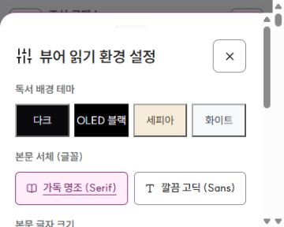

# UI-R7 — 회귀·접근성·성능·배포 점검

작성일: 2026-10-31 · 상태: **수정·자동 검증·배포 조회 인수 완료 — 아래 미실행 항목 별도** · 기준: [R6 결과](ui-r6-operations-account-2026-10-31.md), [UI 계획](ui-redesign-plan-2026-10-30.md), [운영 인수](../../improve37.md)

## 발견한 문제와 수정

| 실제 근거 | 수정 |
| --- | --- |
| 공개 회차에 `readerCommentInput`이 두 번 생성됨. 동적 입력창의 글을 제출 함수가 앞쪽의 다른 입력창에서 읽는 구조 | 정적 중복 작성기를 제거하고 기존 동적 작성기 하나를 사용. 댓글·답글 라벨과 등록 버튼 ID를 연결. 기존 보안 API·작품/회차 식별자·호환 함수 유지 |
| 독서 설정 5개 그룹의 현재 선택이 `active` 클래스에만 있고 `aria-pressed`가 없음 | 실제 설정값과 같은 기준으로 선택 상태를 갱신. 계정 초기화·기기/서버 복원·다른 옵션 보존 검증 |
| 설정·검색·더 보기의 대화상자 이름 또는 아이콘 닫기 이름이 없음 | 실제 제목과 dialog 연결, 닫기·검색 입력·설정 그룹·글자 크기 조작에 이름 제공 |
| 실제 375×300px에서 설정 창 높이 326px, 상단 -26px로 잘림 | 본문만 제한하던 높이를 대화상자 전체 제한·스크롤로 변경. 글자 크기 버튼은 44×44px |
| 작품 관리 메뉴가 변경 검토를 안내하지만 실제 공개본 검토는 `/admin/cases`에 있음 | 검토 권한이 있는 현재 계정에 기존 검토 화면으로 가는 진입점 추가. 클릭 시 현재 화면·계정·권한 재확인 |

새 회차 최초 발행에 관리자 사전 검수를 추가하지 않았다. 공개 후 수정·삭제 검토, 동결된 사유/결정 재시도와 서버 권한은 유지한다.
DB 스키마·운영 플래그·결제/PASS·원고 엔진·실제 작품 데이터는 변경하지 않았다.

## 자동 검증

신규 테스트는 접근성·설정/초점 8개, 실제 Auth·서재·지원함·댓글/관리자 탐색 통합 6개, 배포 감사 도구 11개로 총 **25개**다.
정적 ID 맵만으로 찾지 못했던 댓글 중복은 실제 HTML과 동적 댓글 DOM을 합쳐 검사하고, 사용자가 입력한 실제 textarea의 값이 올바른 작품·회차로 전달되는지 확인한다.
같은 표시 이름을 사용하는 서로 다른 계정 사이의 늦은 응답·재시도·기기 사본을 실제 모듈 조합으로 검사한다.

[검증 기록](../../artifacts/ui-r7-verification-2026-10-31.json)에서 전체 릴리스·타입·보안·추가 회귀 결과를 확인한다.
전체 릴리스 실행을 시작한 후 추가한 관리자 탐색과 자산 버전 변경은 해당 UI·접근성·통합 테스트를 별도로 재실행하고, 최종 R7 단계에도 포함한다.
전용 lint 명령·커버리지 임계값은 구성되어 있지 않아 통과로 표시하지 않는다.

| 검증 | 결과 |
| --- | --- |
| 전체 릴리스·빌드 | 45개 릴리스 명령과 Prisma·TypeScript 컴파일 PASS, 종료 코드 0 |
| 신규 R7 회귀 | 접근성 8 + 통합 6 + 배포 감사 11 = 25/25 PASS |
| 추가 UI 재검증 | 관리자 탐색·R5/R6 자산 계약·R7 접근성/통합 34/34 PASS |
| 타입 | 설치된 TypeScript CLI `--noEmit` PASS |
| 구문·보안 | JS 10개 구문 검사, 변경 대상 12개 파일 비밀값 패턴 0건, 권한·서버·DB 스키마·정책 보존 |
| 배포 인수 | 수정 커밋 `749b4e1`의 GitHub CI·Cloudflare 성공, 변경 자산 5/5 일치·실제 화면 재확인 PASS |

## 실제 브라우저 인수 범위

사용자의 UI-R7 실행 요청에 따라 배포된 공개 사이트를 확인했다. 별도 명시 승인을 받은 관리자 로그인은 조회만 수행했다.
자격 증명은 화면·기록 파일에 남기지 않으며, 작품·계정·문의·승인 결정을 수정하지 않는다.
일반 로그인·열람에 수반되는 인증 세션과 기술 관측은 조회 인수 과정에서 발생할 수 있으며, 업무 데이터 수정과 구분한다.

기준 관찰 기록은 [브라우저 인수 기록](../../artifacts/ui-r7-browser-2026-10-31.json)에 보관한다.
CSS viewport를 320·375·390·768·1024·1440px로 설정한 데스크톱 Chromium 계열 인수이며 실제 휴대폰과 구분한다.
Windows 스크롤바 때문에 문서의 실제 clientWidth는 요청 폭보다 15px 작은 경우가 있다.

| 영역 | 확인 |
| --- | --- |
| 공개 홈·웹툰 탐색·회사·약관·환불정책 | 6개 폭에서 페이지 전체 가로 넘침 없음. 320px 주요 메뉴 내부 스크롤은 정상적인 탐색 영역으로 구분 |
| 작품 상세·소설 뷰어 | 실제 조선 로맨스 10개 공개 회차, 첫 회차와 실제 본문·이전/다음 상태, 모바일 표지 비율·읽기 행동 |
| 로그인·가입 | 키보드 방향키 선택·초점·ARIA 동기화, 375×300px 가입 창의 전체 높이 수용 |
| 관리자 | 실제 로그인, 권한/기능에 따른 13개 메뉴, 대시보드 6개 폭, 작품 메타데이터·지원함·운영 관측·서비스 설정 조회 |
| 관리자 변경 검토 | `/admin/cases`에서 발행 후 변경 검토·빈 요청 상태 확인. 실제 승인·반려는 실행하지 않음 |
| 외부 서비스 | 결제·PASS 미설정 안내와 저장/실제 운영 승인 구분. 키 입력·기능 활성화 없음 |
| 계정 경계 | 관리자 로그아웃 후 비공개 작업 영역이 정리되고 공개 홈으로 돌아옴 |

### 수정 배포 후 재확인

`749b4e1f52b0bdef79fbc713df85577e2f5f5f01`의 CI와 Cloudflare Pages가 모두 성공했다.
[변경 자산 대조](../../artifacts/ui-r7-delivery-2026-10-31.json)는 HTML·독서 JS/CSS·역할 로더·관리자 workflow 5개 모두 200·일치·발견 사항 0건이다.
정책 등 나머지 자산을 최종 시점에 다시 내려받았다고 해석하지 않는다.

- 실제 상세·소설 뷰어를 6개 폭에서 재확인했다. 페이지 전체 가로 넘침이 없었다.
- 댓글 textarea·등록 버튼은 각각 1개이며, 화면에 표시된 작성기에 라벨이 연결된다. 실제 댓글은 게시하지 않았다.
- 375×300px 설정 창은 상단 16px·높이 284px·하단 300px로 화면 안에 들어오고 창 전체가 스크롤을 담당한다.
- 선택한 5개 설정이 접근성 트리에 전달되고, Escape 후 `btnReaderSettings`로 초점이 돌아온다.
- 작품 관리의 검토 진입 버튼이 기존 `/admin/cases` 검토함을 열었다. 승인·반려는 실행하지 않았고 관리자 세션은 로그아웃했다.



### 확인하지 못한 인수

- 실제 200% 브라우저 확대: 자동화의 확대 단축키가 CSS viewport를 바꾸지 않아 확인 완료로 처리하지 않는다. 좁은 폭·짧은 높이 검증과 구분한다.
- 음성 스크린리더와 물리 모바일 키보드: 접근성 트리·실제 키보드 조작·VM 테스트가 음성/실기기 인수를 대체하지 않는다.
- 작가 본인 계정의 실제 Word 붙여넣기·파일/웹툰 업로드·저장/예약·공개 후 수정 승인: 이번 운영 브라우저 인수에서는 실행하지 않았다. 기존 자동 테스트와 운영 데이터 변경을 구분한다.
- 공개 웹툰이 없어 실제 공개 웹툰 컷 로딩·화면 맞춤은 브라우저에서 확인하지 못했다. 기존 웹툰 렌더러·순서·오류·재시도 테스트 결과를 별도로 유지한다.
- 실제 문의 작성→관리자 답변→재개, 서로 다른 PostgreSQL 두 연결 경쟁, SMTP 수신·PASS/Toss 계약 인수는 별도 운영 과제다.

## 성능·배포 측정

새 `npm run audit:ui-delivery`는 기본적으로 오프라인 공개 UI 자산 목록을 만든다.
명시한 신뢰 가능한 공개 origin을 대상으로만 HTTP 검사를 실행한다. `.env`·인증·API·공개 설정값·작품 이미지·외부 호스트를 수집하지 않는다.

```powershell
npm run audit:ui-delivery
npm run audit:ui-delivery -- --origin https://webnovels-db4.pages.dev
npm run audit:ui-delivery -- --origin https://webnovels-db4.pages.dev --only / --only /js/reader/reader.js?v=20261031r7 --only /css/reader-experience.css?v=20261031r7 --only /js/core/role-modules.js?v=20261031r7 --only /js/admin/admin-workflow.js?v=20261031r7
```

도구는 96개 자산·4개 동시 요청·응답당 2MB·한 차례 재시도로 제한한다. 리디렉션을 따라가지 않고 사용자명/비밀번호가 포함된 origin과 비공개 경로를 거부한다.
이 도구는 신뢰하는 origin을 점검하는 로컬 CLI이며 임의 악성 도메인의 DNS/IP를 증명하는 서버가 아니다.
파일 비교는 원문과 CRLF→LF 정규화 해시를 구분한다. 검사한 자산 범위 밖의 모든 파일이 같다고 보증하지 않는다.
CSP는 실제 강제 정책과 report-only를 나누고, `base-uri`·`object-src`·`frame-ancestors`가 추가 출처로 확대되면 실패한다.

기준 HTTP 스냅샷은 71개 자산 모두 200이었다. 당시 수정 중인 reader.js만 배포본과 달랐으며 최종 배포 일치 결과와 구분한다.
초기 로컬 자산 목록은 약 2.75MB이며, 모든 역할 지연 모듈을 포함한 파일 합계다. 실제 최초 전송량이나 페이지 성능 점수로 해석하지 않는다.
Brotli 응답은 관측했지만 Content-Length가 없는 응답의 압축 크기·비율은 추정하지 않는다.

초기 브라우저 탐색의 단일 비통제 표본에서는 TTFB 약 383ms, DOMContentLoaded 약 1,485ms, load 약 1,538ms였다.
그 표본은 R6 배포 갱신 전 첫 탐색이며, 최종 R7 비교 벤치마크나 개선율이 아니다.
Google Fonts CSS는 해당 표본에서 인코딩 162,387바이트·디코딩 662,314바이트·약 328ms로 관측되었다.
LCP·CLS·실사용자 Core Web Vitals 또는 Lighthouse 점수는 측정하지 않았다.

## 다음 개발 — UI-R8와 운영 인수

1. **UI-R8: 작가 실기기 인수·성능 개선** — 별도 인수 계정·비공개 자료로 Word 붙여넣기, 이미지 순서, 기기 사본, 즉시/예약, 공개 후 변경 요청·검토 왕복을 확인한다.
2. 실제 200% 확대, 음성 스크린리더, 휴대폰 키보드와 짧은 높이에서 초점·저장 상태를 인수한다.
3. 독서용 Google Fonts 지연 로드는 기존 Noto 서체를 유지하고 stylesheet 로드→`document.fonts.ready`→현재 ReaderSession·수동 스크롤을 확인한 뒤 읽은 위치 복원과 함께 검증한다. [MDN disabled stylesheet](https://developer.mozilla.org/en-US/docs/Web/API/HTMLLinkElement/disabled)
4. Lucide 전체 번들(기준 디코딩 446,378바이트)을 사용 아이콘 빌드로 줄이는 방안을 비교한다. 기존 아이콘·클래식 로드 순서·SRI 검증이 선행 조건이다.
5. SMTP·독립 복원·지원 기록 보존·외부 인증/결제·운영 동시성은 기존 37단계 조건을 충족한 뒤 별도로 인수한다.

이 결과는 전체 베타 오픈 또는 WCAG 적합성 인증이 아니다. 실행한 자동 검증·실제 조회·배포 파일 일치와 남은 운영 인수를 구분한다.
